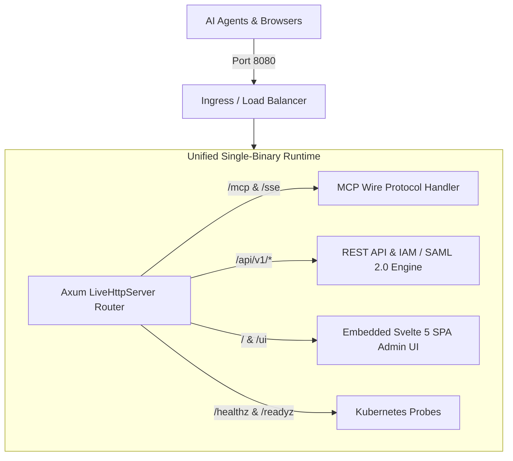

# Phase 53: Zero-Friction OCI Container-Ready Unified Runtime & Vendor-Neutral Packaging

> **Milestone Tag**: `v1.53.0-zero_friction_oci_container_ready`  
> **Status**: `In-Progress`  
> **Target Enterprise Gaps & Standards**:
> - Single-Port Unified OCI Image serving MCP streaming, REST IAM APIs, and Embedded UI on port 8080.
> - Rootless security context (`UID 10001:10001`) with read-only root filesystem compatibility.
> - Cloud-agnostic deployment packaging: Production Helm 3 Chart and Docker Compose.
> - 12-Factor App configuration via environment variables with zero proprietary vendor lock-in.
> - Container preflight health diagnostics and Kubernetes liveness/readiness conformance.

---

## 1. Problem Statement & Motivation

As AI agent architectures mature in 2026, enterprise platform engineering teams reject multi-container sprawl for AI gateways. Managing separate pods for proxy routing, authentication sidecars, and administration UIs introduces unnecessary operational friction, complex Ingress routing, and increased latency.

Furthermore, enterprise infosec standards prohibit running containers as `root` or mounting host paths. Propylon Gateway must be packaged as an OCI-compliant, self-contained, rootless binary that deploys in 60 seconds across any cloud provider (AWS, GCP, Azure, Bare-Metal, OpenShift, Nomad, or PaaS like Coolify) without vendor lock-in.

---

## 2. Technical Architecture & Invariants

### Key Enterprise Invariants:
1. **Single Unified Port**: All protocols multiplexed on port `8080` without requiring external sidecars.
2. **Strict Rootless Execution**: Runs as unprivileged user `propylon:propylon` (`UID 10001:10001`).
3. **Packaging Neutrality**: First-class Helm 3 Chart (`deploy/helm/propylon/`) and Docker Compose (`deploy/docker-compose.yml`).
4. **Secret Store Agnosticism**: Supports raw environment variables, Kubernetes Secrets, Infisical Universal Auth, HashiCorp Vault, or AWS Secrets Manager.

---

## 3. Implementation Deliverables

- **Helm 3 Chart**: `deploy/helm/propylon/` (Chart.yaml, values.yaml, templates/deployment.yaml, templates/service.yaml, templates/ingress.yaml).
- **Production Compose**: `deploy/docker-compose.yml` with healthchecks and persistent data volume mounts.
- **Container Self-Diagnosis**: Container environment preflight tests verifying non-root permissions and port binding.
- **Graduated Test Suite**: `tests/phase53_container_ready_and_zero_friction_test.rs`.
